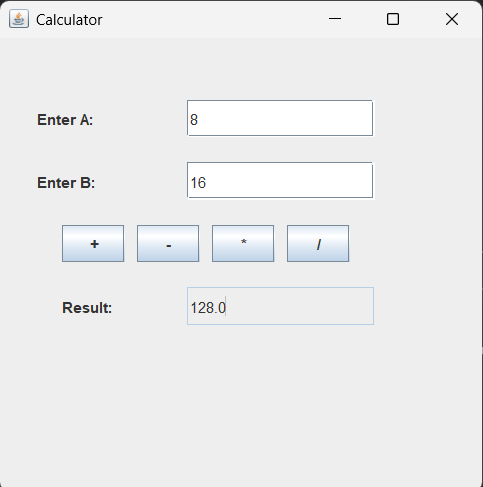

# Java Calculator (MVC)

## 📌 Project Description
This project is a simple Java Calculator developed using the MVC (Model-View-Controller) architecture. It performs basic arithmetic operations through a graphical user interface built with Java Swing.

## ✨ Features
- Addition
- Subtraction
- Multiplication
- Division
- Invalid Input Handling
- Simple and User-Friendly Interface

## 🛠 Technologies Used
- Java
- Java Swing
- MVC Architecture

## 📂 Project Structure

- Main.java - Starts the application.
- Cviews.java - Creates the graphical user interface (GUI).
- Ccontroller.java - Handles button click events and user input.
- Cmodels.java - Performs arithmetic calculations.

## ▶️ How to Run
1. Compile all Java files.
2. Run `Main.java`.
3. Enter two numbers.
4. Click any operation (+, -, *, /).
5. The result will be displayed in the Result box.

## 📸 Output
The application displays a calculator window where users can perform basic arithmetic operations and view the result instantly.

## 📸 Screenshot

## 👨‍💻 Author
**Achintya Agrawal**
B.Tech First Year
Global Institute of Technology
