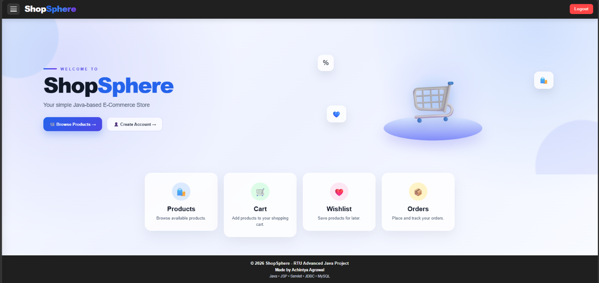

# ShopSphere — Java E-Commerce Web Application



*ShopSphere — Online Shopping Website*

ShopSphere is a Java-based e-commerce application developed as an Advanced Java academic project. It provides an online shopping experience with product browsing, user accounts, cart management, wishlist, checkout, and administrative features.

## Features

### Customer Features
- User registration and login
- Browse products and view product details
- Add products to the shopping cart
- Manage wishlist items
- Checkout and payment workflow
- View orders and order history
- Manage user profile

### Admin Features
- Admin login
- Manage products and categories
- Manage customer orders
- Manage users
- Coupon management
- View reports and dashboard information

## Technologies Used

- **Programming Language:** Java
- **Web Technologies:** JSP, Servlets, HTML, CSS, Bootstrap
- **Database:** MySQL
- **Database Connectivity:** JDBC
- **Web Server:** Apache Tomcat
- **Build Tool:** Apache Maven
- **Desktop Admin Module:** Java Swing

## Project Structure

```text
ShopSphere/
├── pom.xml
├── product.ser
├── swing-admin/
│   └── src/
└── web/
    └── src/
        └── main/
            ├── java/
            └── webapp/
```

## Prerequisites

Install the following software before running the project:

- Java Development Kit (JDK)
- Apache Maven
- Apache Tomcat
- MySQL Server and MySQL Workbench

## Database Configuration

1. Start MySQL Server.
2. Create the database required by the project.
3. Configure the database connection settings in the project's database connection utility.
4. Ensure that the database credentials and table structure match your local MySQL setup.

**Important:** Update local database credentials before running the application. Do not publish real passwords or secrets in the repository.

## How to Run

1. Clone or download the repository.
2. Open the `ShopSphere` folder in Visual Studio Code or another Java IDE.
3. Configure the JDK, Maven, and MySQL environment.
4. Verify the database configuration.
5. Build the project using Maven.
6. Deploy the generated WAR file to Apache Tomcat, following the project's deployment configuration.
7. Start Tomcat and open the application using its configured local URL.

Refer to the project configuration and source files for the exact database name, build command, deployment context path, and application URL.

## Learning Objectives

This project demonstrates practical implementation of:

- Java programming and object-oriented concepts
- JSP and Servlet-based web development
- JDBC and MySQL database integration
- MVC-style application organization
- Session-based user functionality
- Maven-based project management
- Web application deployment using Apache Tomcat
- Java Swing desktop interfaces

## Academic Project

Developed for learning and demonstrating Advanced Java concepts and practical software development skills.


## 🔗 Project Links

- 🌐 **Live Website:** [ShopSphere — Online Shopping](https://shopsphere-rue9.onrender.com/products)
- 💻 **GitHub Repository:** [Java_lab](https://github.com/Achintya130607/Java_lab)
- 👨‍💻 **Developer Profile:** [Achintya130607](https://github.com/Achintya130607)

## 👨‍💻 Author

**Achintya Agrawal**  
B.Tech Computer Science Student

ShopSphere is an Advanced Java academic project developed to demonstrate Java web development, database connectivity, and e-commerce functionality.

